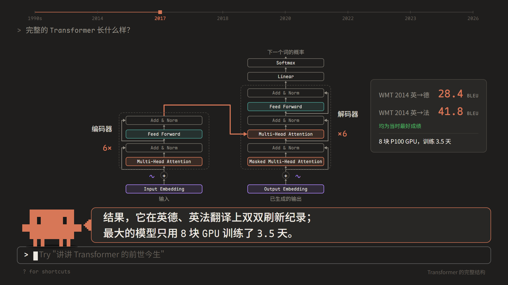
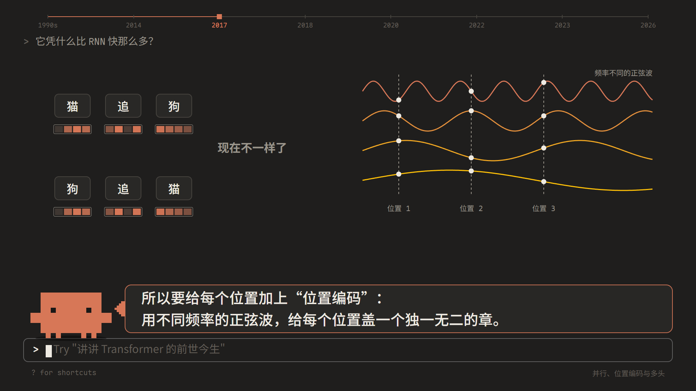
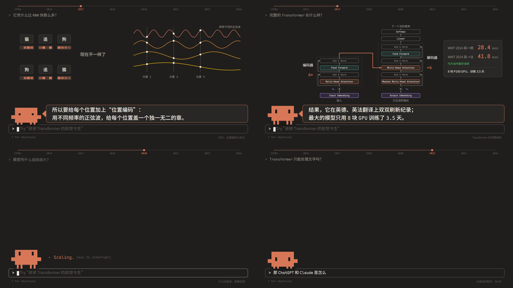

# Clawd: Transformer 的前世今生 (Claude Say Transformer)

<div align="center">


**一部用纯代码编写、渲染与合成的动画科普片**  
Anthropic Claude Code 的标志性橙色像素小人 **Clawd** 登台开讲，带你重走从传统循环神经网络到现代大语言模型的十年演进史。

[在线交互预览](#-快速上手) • [核心亮点](#-项目亮点) • [影片章节](#-章节大纲) • [离线渲染引擎](#-制作与渲染工具箱) • [技术架构](#-技术架构)

</div>

---

## 📸 精彩画面一览

| 完整 Transformer 架构解析 | 正弦/余弦位置编码与并行计算 |
| :---: | :---: |
|  |  |

| 分镜总览 (Contact Sheet) |
| :---: |
|  |

---

## 🌟 项目亮点

- 🎬 **代码即分镜，GSAP 帧精度时间轴驱动**  
  全片约 7 分多钟的高清动画完全由一条单一全局 GSAP Timeline 编排驱动。告别传统非线性剪辑软件的繁琐对齐，时间精确到毫秒级，支持随时 seek 至任意时刻进行高精度画面断言。
- 👾 **活灵活现的像素小人 Clawd**  
  使用纯 DOM + CSS 与 SVG 像素矩阵构筑的橙色像素主角 Clawd，具备站立呼吸、奔跑巡场、气泡对话自适应停靠、敲击终端输入等多种细腻表情与肢体语言。
- 🎵 **自研纯 Web Audio 8 复音电子配乐与音效引擎**  
  全片内置无外部音频采样的纯算法声学合成器。基于 `OfflineAudioContext` 实时合成 8 轨道芯片风/氛围电子配乐（Pad 垫音、Bass 贝斯、Arp 琶音、Lead 主音、Bell 钟鸣、Kick 底鼓、Snare 军鼓、Hat 踩镲），并动态绑定终端敲击等环境音效，和弦与节奏严格呼应画面转折。
- ⚡ **分段多进程 Headless 浏览器离线视频导出**  
  拥有高效的离线渲染管线：针对长达数万帧的动画，Puppeteer 集群将其切为多个分段，由独立的 Chrome 实例并行逐帧截图并无损直推至 FFmpeg 管道，同时后台离线并行合成全长音轨，最后秒级无损合并为 1080p 60fps 广播级 MP4 成片。
- 📐 **专业公式排版与动态数据可视化**  
  结合 KaTeX 渲染标准数学公式（如 Scaled Dot-Product Attention、Softmax、Embedding 公式），并利用矢量图形与 CSS 矩阵动态展示注意力权重热力图、多头分块与正弦波叠加。
- 🕹️ **双重模式体验**  
  - **交互播放模式**：在本地浏览器中具备完整的进度控制条、快捷键操作（空格暂停/播放、左右箭头快进快退、上下箭头换章）、分段章节标记与缩放自适应。
  - **无损渲染模式**：支持字体预热屏障（Font Barrier）确保无字体闪烁，配合命令行脚本全自动导出。

---

## 📖 章节大纲

本片以深色极客终端为舞台背景，系统性回顾了现代自然语言处理的范式变迁：

| 序号 | 章节标识 | 章节名称 | 核心知识点与画面展现 |
| :---: | :---: | :--- | :--- |
| **01** | `intro` | **开场启幕** | Clawd 从 Claude Code 交互框跳出，拉开技术演化序幕 |
| **02** | `rnn` | **前世：RNN / LSTM** | 序列时序展开、隐藏状态传递机制、长距离依赖遗忘与梯度消失瓶颈 |
| **03** | `seq2seq` | **前世：Seq2Seq 架构** | Encoder-Decoder 结构与固定长度上下文向量 $C$ 的信息压缩瓶颈 |
| **04** | `attention` | **转机：注意力机制** | Bahdanau 注意力突破：动态查询、全局对齐权重与软寻址计算 |
| **05** | `paper` | **诞生：经典论文** | 2017 年 Google 轰动学术界的里程碑论文《Attention Is All You Need》 |
| **06** | `selfattn` | **核心：自注意力机制** | 查询向量 $Q$、键向量 $K$、值向量 $V$ 的几何直觉与点积注意力公式剖析 |
| **07** | `parallel` | **核心：并行与位置编码** | 摆脱时序循环依赖实现全序列并行，利用不同频率正弦/余弦波赋予位置印记，多头注意力捕捉不同表征子空间 |
| **08** | `arch` | **核心：完整架构解析** | 残差连接 (Add & Norm)、前馈网络 (FFN) 层层堆叠；刷新 WMT 英德/英法翻译 SOTA 纪录 |
| **09** | `split` | **今生：BERT vs GPT** | 路线大分野：自编码双向理解（BERT）与自回归单向生成（GPT）的技术博弈 |
| **10** | `scale` | **今生：规模定律** | OpenAI Scaling Laws：计算量、参数量、数据量协同增长下的智能涌现与“大力出奇迹” |
| **11** | `tokens` | **今生：万物皆可 Token** | 从文本词表到代码、声音乃至视觉 Patch，统一的多模态 Token 宇宙 |
| **12** | `chat` | **今生：从接龙到助手** | 预训练自回归的“胡言乱语”，通过 Instruction Tuning、RLHF 人类对齐进化为 ChatGPT 与 Claude |
| **13** | `now` | **尾声：今天与明天** | 回归现代化开发日常，致敬每一位推动人工智能与大模型发展的探索者 |

---

## 🛠️ 技术架构

```
ClaudeSayTransformer/
├── public/                 # 静态资产 (Clawd SVG 基础图标等)
├── src/
│   ├── clawd/              # 主角 Clawd 像素精灵与行为逻辑 (Sprite, Clawd)
│   ├── lib/                # 底层支撑库
│   │   ├── colors.ts       # 配色规范与调色板定义
│   │   ├── dom.ts          # 轻量原生 DOM 节点构建辅助函数
│   │   ├── viz.ts          # 注意力矩阵、折线图等数据可视化组件
│   │   └── wav.ts          # PCM 音频转 WAV 二进制编码器
│   ├── scenes/             # 13 个独立场景分镜脚本 (intro, rnn, selfattn, arch 等)
│   ├── ui/                 # 交互界面与音频合成器
│   │   ├── banner.ts       # 章节时间线导航横幅与跑马灯
│   │   ├── bubble.ts       # Clawd 像素对话气泡排版
│   │   ├── score.ts        # 8 复音算法电子音乐编曲乐谱与合成编排
│   │   ├── sfx.ts          # 终端打字、转场、按键声效生成器 (Web Audio API)
│   │   └── terminal.ts     # 终端窗口、命令提示符模拟与输入动画
│   ├── cover/              # 视频封面排版与渲染逻辑
│   ├── director.ts         # 导演类：统一编排分镜、音轨 cue、时钟标记
│   ├── layout.ts           # 1920x1080 舞台常数与全局布局配置
│   ├── main.ts             # 启动入口：字体屏障加载、播放器挂载与导出接口暴露
│   └── player.ts           # 浏览器全功能交互式播放器实现
├── scripts/                # Node.js 生产工具集
│   ├── browser.mjs         # Headless 浏览器会话管理封装
│   ├── cover.mjs           # 自动导出 16:10 / 16:9 视频封面图
│   ├── render.mjs          # 分段并行多进程 1080p 逐帧渲染与 FFmpeg 拼接
│   ├── audio.mjs           # 独立重绘/导出音轨并重新混流视频
│   ├── score-report.mjs    # 配乐曲式结构、小节、BPM 与和弦巡检报告
│   ├── sheet.mjs           # 截取画面拼合 2x2 分镜总览图 (Contact Sheet)
│   └── snap.mjs            # 指定时间点/章节毫秒级高精度快照抓取
└── shots/                  # 高清画面实拍截图
```

---

## 🚀 快速上手

### 1. 环境准备

- **Node.js**: `>= 18.0.0`
- **FFmpeg**: 需配置在系统环境变量 `PATH` 中（用于视频合成与音频封装）
- **Chrome / Chromium**: 本机已安装常规 Chrome 即可，Puppeteer 会自动检测系统路径

### 2. 安装与运行

```bash
# 克隆仓库
git clone https://github.com/Sparrived/claude-say-transformer.git
cd claude-say-transformer

# 安装依赖
npm install

# 启动本地开发与交互播放器
npm run dev
```

在浏览器打开 `http://localhost:5173/` 即可观看并操作。

### 3. 播放器快捷键

- `Space`：播放 / 暂停
- `←` / `→`：快退 5 秒 / 快进 5 秒
- `Shift + ←` / `Shift + →`：快退 1 秒 / 快进 1 秒
- `↑` / `↓`：跳转至上一个章节 / 下一个章节
- `F`：全屏切换
- `M`：静音切换

---

## 🎛️ 制作与渲染工具箱

项目包含了一套专为长视频动画打造的自动化渲染与音频工程脚本：

### 1. 导出完整高清视频

```bash
# 默认使用 6 个独立浏览器分段并行渲染出 30fps 的高清 MP4（输出至 out/clawd-transformer.mp4）
npm run render

# 指定 60fps 高帧率、8 个渲染进程
npm run render -- --fps 60 --workers 8

# 只渲染特定时间段（例如从第 120 秒到 150 秒）
npm run render -- --from 120 --to 150 --out out/part.mp4
```

### 2. 独立音频二次混流（秒级生效）

当调整了配乐和弦或音效参数时，无需耗费时间重新导出全部视频帧：

```bash
# 将当前最新编曲音轨替换进已有视频，生成 out/clawd-transformer-music.mp4
npm run audio

# 仅导出纯 WAV 音频文件进行独立试听分析
npm run audio -- --wav out/soundtrack.wav --only music
```

### 3. 音乐乐理结构报告

```bash
# 控制台打印全片乐理小节、BPM 变速点、各乐器声部音符数分布
npm run score
```

### 4. 一键生成高清视频封面

```bash
# 自动截取生成适用于主流视频平台的封面图（输出至 out/cover-16x10.png 与 out/cover-16x9.png）
npm run cover
```

### 5. 任意时间点或章节精准截图

```bash
# 截取指定绝对秒数
npm run snap 15.2 60 128.5

# 按章节名称及偏移量截取（例如 rnn 章节开始后第 3 秒）
npm run snap ch:rnn+3 ch:arch+10
```

---

## 🤝 贡献与致敬

欢迎提交 Issue 和 Pull Request 一同改进动画细节、补充更多模型故事！

- 致敬 **Anthropic** 打造的 [Claude](https://claude.ai) 与 Claude Code 终端助手生态。
- 致敬 2017 年《Attention Is All You Need》论文所有作者及推动 Transformer 与大语言模型开源生态的全球科研先锋。

---

## 📄 开源许可证

本项目基于 [MIT License](LICENSE) 开源。
